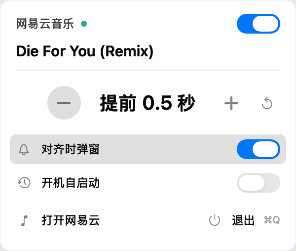

# Halfbeat（歌词对齐）

**[下载最新版本 →](https://github.com/edanhuang/halfbeat/releases/latest)**（macOS · 通用二进制）

网易云的歌词总差那么半拍，一首首手动调太麻烦。Halfbeat 是一个 macOS 菜单栏小工具：把歌词自动对齐到你设定的偏移，默认提前 0.5 秒，切歌、重播都会自动生效。



## 功能

- **自动对齐**：当前歌曲、切歌后加载的歌词、目标值变化都会对齐到设定值；已经对上就不重复调整。停用后停止自动调整，保留当前偏移。
- **菜单栏面板**：显示当前歌曲和目标偏移。`−` / `+` 每次调 0.5 秒，`⟲` 归零；右上角开关可以随时停用。
- **对齐时弹窗**：右下角弹一张小卡片显示歌名和偏移，可以关掉。
- **开机自启动**：面板里一键开启。
- **不碰客户端**：不修改网易云本体、不写它的歌词缓存，只通过它自带的本机调试接口调整运行时偏移。
- **版本自检**：客户端接口对不上时，面板会提示「网易云音乐版本不兼容」，点一下可复制诊断信息。

## 使用

1. 把 `歌词对齐.app` 拖进 `/Applications`；
2. 首次打开被系统拦下时，右键 → 打开；
3. 点菜单栏图标打开面板。如果网易云是普通方式启动的，第一次会自动重启一次播放器（让本机调试接口生效），播放会中断几秒。

**要求**：macOS 13+（Apple Silicon 或 Intel，通用二进制）、网易云音乐 3.1.14（其他版本未验证）。

## 构建

```sh
zsh build.sh          # 需要 Xcode Command Line Tools，产物在 dist/歌词对齐.app
node test-bridge.cjs  # 行为回归测试，需要 Node.js
```
